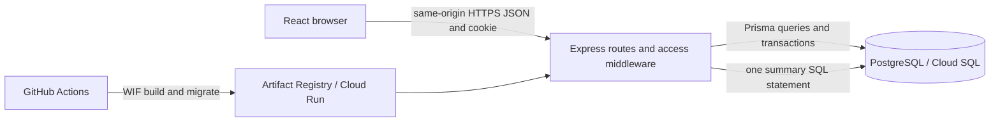
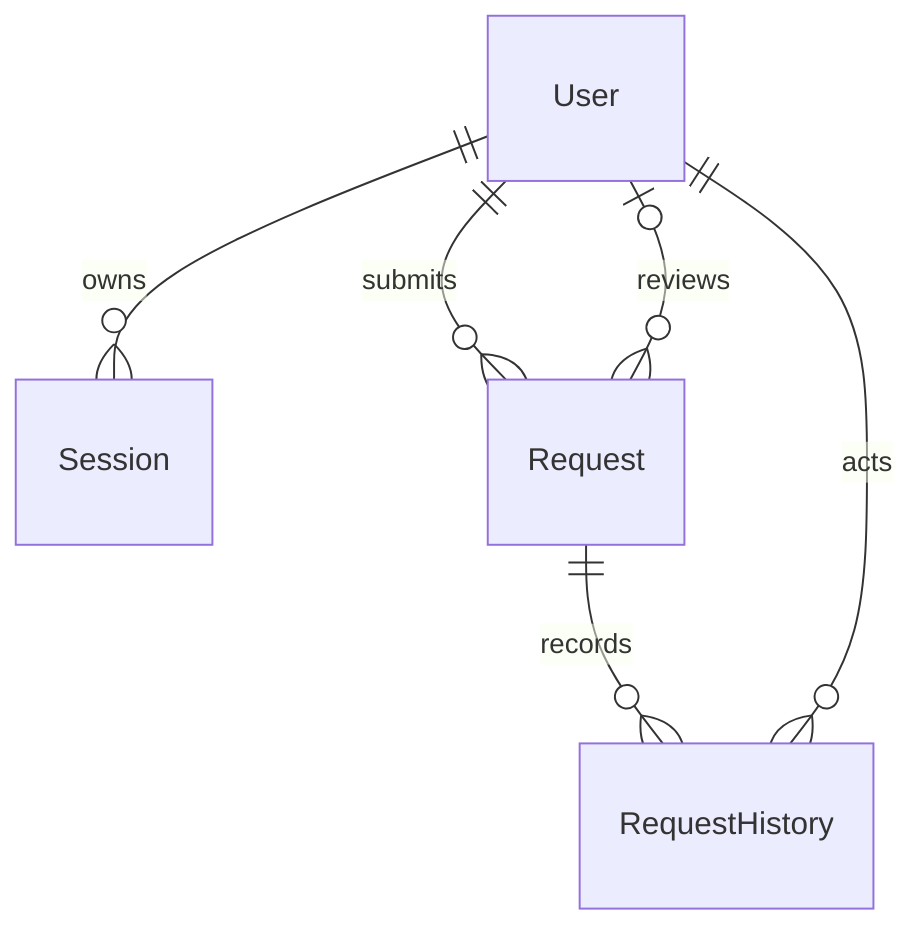

# System-Level Software Design Specification

**Product:** Workflow and Approval System (university department) | **Version:** 0.4 | **Date:** 26 November 2026 | **Issue:** #74; Lab 7 CR-L7-01 proposed update

Implemented design at main `0877808fb5a8084e040974cb56b16648b274bb04`, tag `f10-2026-11-25`, revision `approvals-r45637901908-1`. [SRS](srs.md), [inventory](features.md), [result matrix](traceability.md). Planned F-09 is distinguished from actual behavior/schema. Prior v0.1 remains in Git.

## 1. Architecture and modules

The modular monolith uses React/TypeScript, React Router and Bootstrap, built with Vite; Node.js 24/Express/TypeScript handles HTTP and transactions; Prisma 6.19.3 connects to PostgreSQL (verified environment 18.6). Node's built-in test runner and Supertest verify API/database behavior; Playwright verifies selected journeys. Vitest and a separate UI component-test suite are not installed.



| Actual module | Responsibility |
|---|---|
| `web/main.tsx` | Auth state/routes, forms, authorized lists, detail/history, Returned editor, summary. UI authorization is navigation support, not the security boundary. |
| `src/app.ts` | App factory, sessions, role middleware, JSON/errors, login/logout/me, public health/version. |
| `src/requests.ts` | Ownership, validation, guarded transitions, owner-edit lock and atomic history. Business logic resides in route handlers; no separate service/repository classes exist. |
| `src/request-filters.ts` | Strict query parsing, UTC boundaries and literal Prisma search. |
| `src/reports.ts` | Reviewer-only aggregation from one SQL snapshot. |
| `src/server.ts` | Configuration, Prisma lifetime, static UI/SPA fallback and signal shutdown. |
| `prisma/schema.prisma`, `prisma/migrations/`, `prisma/seed.cjs` | Types/relations, constraints, migrations, synthetic seed. |
| `deploy/release.sh`, `deploy/smoke_test.py`, `.github/workflows/` | Migration-before-rollout, immutable identity, smoke and CI. |

Local `vite.config.mts` proxies `/api` to `http://127.0.0.1:3000`. Production Express serves `web/dist` and an HTML SPA fallback for non-API paths. No CLIENT_ORIGIN setting or separate cross-origin production API is required.

## 2. Identity, session and permissions

DD-01: opaque 256-bit random session ID (64 lowercase hex), persisted with user/expiry. DD-02: eight-hour default absolute expiry, no renewal; presented expired sessions are removed. DD-03: bcrypt, default cost12, allowed10..15; unknown user uses dummy hash. Login validates nonblank username <=255 and password UTF-8 length <=72 bytes. Wrong password/unknown user share generic401 and create no session.

Cookie `session`: HttpOnly, SameSite=Lax, Path=/, Secure in production. Logout deletes current session and clears cookie; replay fails. API has Cache-Control:no-store. Cloud Run terminates HTTPS. No rate limiter, MFA or separate CSRF token is claimed. Public projections exclude password hashes and session identifiers.

| Operation | Anonymous | Requester | Reviewer |
|---|---|---|---|
| Health/version/login | Allowed | Allowed | Allowed |
| Identity/logout | 401 | Own session | Own session |
| Create request | 401 | Owner from session | 403 |
| List/detail/history | 401 | Own only; another owner's detail/history404 | All read-only |
| Claim | 401 | 403 | Pending only, no self, conflict409 |
| Approve/reject/return | 401 | 403 | Assigned actor, In Review, no self; unrelated403 |
| Edit/resubmit | 401 | Own Returned; wrong owner404, wrong state409 | 403 |
| Summary | 401 | 403 | Global; no client-selected scope |
| Withdraw | 401 | Own Pending/unassigned only; Reviewer 403; another owner 404 | 409 outside eligible state |

Identity/role are derived from session, never request body/query. One enum role per account. Same-ID self-approval guards/DB constraints exist, but dedicated synthetic self-claim/self-decision tests are a verification gap.

## 3. Current data model



| Entity | Fields (relations omitted) |
|---|---|
| User | id Int PK, username unique String, passwordHash String, role, createdAt |
| Session | id String PK, userId FK, createdAt, expiresAt |
| Request | id Int PK, title, category, amount Decimal(12,2), justification, state, requesterId FK, nullable reviewerId FK, nullable decisionReason, createdAt, updatedAt, nullable decidedAt |
| RequestHistory | id Int PK, requestId FK, actorId FK, nullable fromState, toState, nullable reason, createdAt |

No displayName or second-stage columns exist. Categories: FUNDING/PURCHASE/TRAVEL/REIMBURSEMENT. Implemented baseline states: PENDING/IN_REVIEW/RETURNED/APPROVED/REJECTED. Proposed CR-L7-01 adds WITHDRAWN but this value is not in the referenced deployed schema. Times are returned as ISO timestamps. Request indexes: requesterId/reviewerId/state; history index: requestId. No pagination or measured1,000-row performance result yet.

Current CHECK constraints enforce positive amount, nonblank title/justification, reviewer absent exactly when Pending, reviewer different from requester, and nonblank rejection/return reason. Proposed CR-L7-01 changes the reviewer/state invariant to allow a null reviewer in Pending or Withdrawn and requires a future migration to update the constraint. Foreign keys preserve references. Request/history writes commit atomically. History is immutable through the application (no mutation routes), not through an immutable-history database trigger.

Migrations, in order:

1. `20261106000100_initial`: baseline schema/constraints.
2. `20261124000100_returned_state`: add enum value in separate committed migration.
3. `20261124000200_returned_reason`: extend reason CHECK after enum is usable.

These additive migrations preserve earlier rows and run via prisma migrate deploy. F-10 adds none. Production release never resets/reseeds. CR-L7-01 proposes a further additive RequestState enum value and reviewer/state constraint update; no such migration is included or deployed in this contract revision. A future rollout must avoid routing new WITHDRAWN rows to a pre-change app revision. Synthetic seed supplies two Requesters/two Reviewers and four original-state fixtures, not every current state; it hashes an environment password and uses controlled upserts/fixture checks.

## 4. Workflow and concurrency

```mermaid
stateDiagram-v2
  [*] --> PENDING: owner submits
  PENDING --> IN_REVIEW: Reviewer claims
  PENDING --> WITHDRAWN: owner withdraws before claim (proposed CR-L7-01)
  IN_REVIEW --> RETURNED: assigned Reviewer returns with reason
  RETURNED --> RETURNED: owner saves effective edit
  RETURNED --> IN_REVIEW: owner resubmits to same Reviewer
  IN_REVIEW --> APPROVED: assigned Reviewer approves
  IN_REVIEW --> REJECTED: assigned Reviewer rejects with reason
  WITHDRAWN --> [*]: terminal; no further actions (proposed CR-L7-01)
```

Submit validates trimmed nonblank title/justification, fixed category and positive THB (<=10 integer/two fractional digits, Decimal12,2), sets owner from session and atomically creates Pending plus initial history fromState=null. Proposed CR-L7-01 adds `POST /api/requests/:id/withdraw` with a guarded `PENDING` + `reviewerId IS NULL` + owner update and history append in the same transaction. Concurrent claim/withdraw is resolved by the conditional update: one succeeds and one conflicts. This route and state are not implemented in the referenced baseline. Claim guarded by expected Pending assigns one Reviewer; two competing calls yield one200/one409 and one event. Decisions/return check assigned actor, In Review and no self, then guarded update plus event in one transaction. Reject/Return require trimmed reason; approval reason optional. Final decision sets decidedAt; Return clears it and retains reviewer.

Returned edit/resubmit acquires an owner-scoped SELECT FOR UPDATE row lock inside its transaction before state/read/write. PATCH allows only title/category/amount/justification, rejects unknown/protected keys and arrays, validates values. Effective edit writes one RETURNED->RETURNED event (`Request details updated.`); no-op writes neither history nor updatedAt. Resubmit accepts `{}`, validates stored fields, keeps reviewerId, goes to IN_REVIEW and clears current reason/decidedAt; old reason stays in history. Duplicate resubmit gives one success/one409; edit/resubmit races serialize. Approved/Rejected reject later mutations.

## 5. API contract and safe representations

All paths use `/api`. Mutations require JSON. Success `{data:...}`; error `{error:{code,message,fields?}}`. Positive Int32 IDs only; invalid/missing/private records404. Statuses:201 create,200 read/update,400 validation/query,401 session,403 role/actor,404 private/missing,409 state/race,415 JSON required,413 parser-size limit,500 generic unexpected,503 database-unready health. Unexpected errors log the error name, not connection details.

| Method/path | Input | Output |
|---|---|---|
| GET `/version` | none | Public commit from RELEASE_COMMIT (local fallback), no DB |
| POST `/requests/:id/withdraw` (proposed CR-L7-01) | `{}` | 200 updated request; eligible owner only; 401/403/404/409 on failures, with no failed mutation |
| GET `/health` | none | Database SELECT1, status ok or generic503 |
| POST `/auth/login` | username,password | Public user + cookie |
| GET `/auth/me` | none | Public session user |
| POST `/auth/logout` | `{}` | Revoke current session, clear cookie |
| POST `/requests` | title,category,amount,justification | Pending resource |
| GET `/requests` | state,category,from,to,q; Reviewer-only mine | Authorized results, ID descending |
| GET `/requests/:id` | none | Authorized detail |
| GET `/requests/:id/history` | none | Authorized ordered event array |
| POST `/requests/:id/claim` | `{}` | Assigned In Review resource |
| POST `/requests/:id/approve` | optional reason | Approved resource |
| POST `/requests/:id/reject` | reason | Rejected resource |
| POST `/requests/:id/return` | reason | Returned resource |
| PATCH `/requests/:id` | allowed editable fields | Validated Returned resource |
| POST `/requests/:id/resubmit` | `{}` | Same-reviewer In Review resource |
| GET `/reports/summary` | no query keys | Safe global aggregation |

Public auth user is `{id,username,role}`; nested request people `{id,username}`; history actor `{id,username,role}`. History orders createdAt then id ascending, reasons are text not HTML; empty legacy history is displayed honestly. No history mutation API exists.

## 6. Filtering and summary calculations

F-08 accepts scalar allowed query keys; duplicate/nested/unknown/forged scope keys400. Ownership/Mine scope AND all user filters; state/category exact enums. Dates are real YYYY-MM-DD UTC creation days, lower midnight inclusive and upper following midnight exclusive; 9999-12-31 instead uses last representable millisecond (TIMESTAMP3), avoiding Prisma's unsupported following five-digit year. Invalid/reversed range400. q is trimmed, <=200 Unicode code points; case-insensitive literal title OR justification; escape backslash/percent/underscore before Prisma contains.

F-10 shape: `{total,byState:[{state,count}],byCategory:[{category,count}],byReviewer:[{reviewer:{id,username},approved,rejected,total}],unattributedDecisions}`. Enum buckets include zeros. Reviewer rows include actors with attributed terminal decisions, ID order. Proposed CR-L7-01 adds WITHDRAWN to byState/byCategory through the RequestState enum but leaves approved/rejected reviewer-decision totals unchanged. A materialized current-request CTE plus lateral latest matching terminal event runs in ONE static parameterized SQL statement/one MVCC snapshot. Match current terminal state and actual state-changing transition, timestamp then ID descending. Actor must be Reviewer; missing/non-Reviewer legacy actor is unattributed. Never infer final actor from current assignment. Count each terminal request once. State/category sums equal total; Reviewer totals+unattributed equal Approved+Rejected. No amount sums/private request text; any query key400.

## 7. UI behavior

Login, list/new/detail and Reviewer `/summary` routes. Requester sees own list; Reviewer All/Queue/Mine compose with filters. Queue is fixed Pending; Clear retains current Queue/Mine scope; tab changes clear state/preserve other filters. Return uses shared inline reason panel with Reject (reviewed #79 clarification), not a modal. Returned editor must Save before Resubmit; dirty edits disable resubmit. History labels same-state edits as Edited. Summary shows counts, unattributed count, loading/empty/error/retry/refresh.

Read hooks abort obsolete GETs. Handled form failures preserve inputs and busy controls prevent repeat actions where implemented;409 allows refresh without silent discard. Initial auth/me determines login routing; not every later401 automatically redirects. Requester has no Summary link and direct route shows Page unavailable; backend independently returns403. Browser presentation tests use controlled failures/empty data separately from actual API database tests. Exhaustive every-form field errors, busy permutations and UI409 combinations remain NFR-08/F-11 gaps.

## 8. Configuration and reproduction

| Variable | Purpose/default |
|---|---|
| DATABASE_URL | Private PostgreSQL connection |
| TEST_DATABASE_URL | Dedicated migrated test DB, never production |
| SEED_PASSWORD | Synthetic seed password supplied privately |
| PORT | API3000 |
| SESSION_TTL_HOURS | Positive number, default8 |
| BCRYPT_ROUNDS | Integer10..15, default12 |
| NODE_ENV | production enables Secure cookie |
| RELEASE_COMMIT | Public source identity, local fallback |

[README](../README.md) is the command source: npm ci, Prisma generate/migrate, local seed, build/start or Vite/API dev commands. npm test builds TypeScript/Vite then `node --test test/*.test.cjs`; Playwright uses the test configuration and synthetic seed. Keep real secrets out of Git/PDF. Teammate fresh-clone exercise is still unrecorded.

## 9. CI/CD, persistence and rollback

`.github/workflows/ci-docker.yml`: install/generate/migrate with PostgreSQL18, Node tests, seed, Playwright and Docker build for main/staging PRs. `.github/workflows/deploy.yml`: accepted main via Workload Identity Federation, Artifact Registry and Cloud Run, no committed service-account JSON key. Multi-stage Node24 Debian-slim Docker targets build UI/API/Prisma, create migration image, prune runtime dependencies and run as non-root node with OpenSSL.

SHA-tagged app/migration images resolve to immutable digests; migration job completes before app rollout; RELEASE_COMMIT/commit label and UI/health/version smoke establish identity. Durable state resides in Cloud SQL, not container disk. Existing-image rollback skips migration and requires compatible schema. Do not roll back to pre-F-07 after Returned data exists; no automatic enum down-migration. Sprint 2 f9 is compatible with F-10's unchanged schema.

Actual GCP project vertical-set-514506-g8, region asia-southeast1, service approvals, SQL approvals-pg. URL https://approvals-389973748230.asia-southeast1.run.app. Current main/tag/revision above; run 45637901908. Manifest list `sha256:7f70f868ccbd6c6788fd64f68db33840a809b3ed86b572211d011de10bc8abab`, resolved revision manifest `sha256:dbe993bedb54b17804aa031b0d8a1206cd765f272e925c64ea80deb1a1e3165f`; migration execution approvals-migrate-gz4xd completed. [Actual release evidence](deliverable-2/evidence/F10-release/README.md) retains list/child distinction and metadata.

## 10. Verification, future design and revision

Run45637901908 passed 27 Node/API/regression reported tests (including parents/subtests), five Playwright tests and Docker build. Live 61 calls independently reconciled counts and compared #13/#16/#17 resources/full histories across deployment. This is controlled redeploy continuity, not a whole-DB audit or full-history OS-process restart. Earlier Lab 5 separately records restart request continuity. No application tests are newly claimed for this documentation-only refresh.

F-09 PLANNED: amount>=THB 50,000 first approval must await distinct second actor rather than finalize; new state/data/authorization/races/UI follow [Sprint 3 contract](sprints/sprint-3/contracts.md). Neither waiting state nor proposed columns exist now. It will require F-06/F-07/F-10 regression. F-11 must measure local 1,000-fixture p95<500ms, complete all-form UI, hash/log audit, same-ID/decision-race checks, full-history restart and teammate clean setup. Full independent UAT remains separate.

v0.1 (5Nov) planned design is retained in Git. v0.3 (25Nov,#74) reconciles actual modules, Node runner, schema/five states, filters/summary, UI/config and deployed delivery, correcting obsolete displayName/service classes/Vitest/every-state seed claims. Contract/TDD history is unchanged. Teammate review remains required; this is not instructor scope approval.
